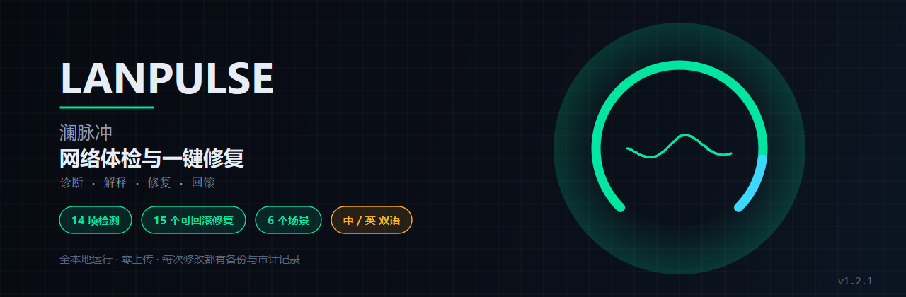
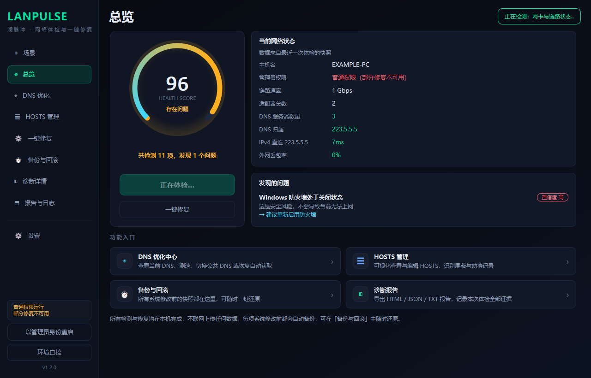
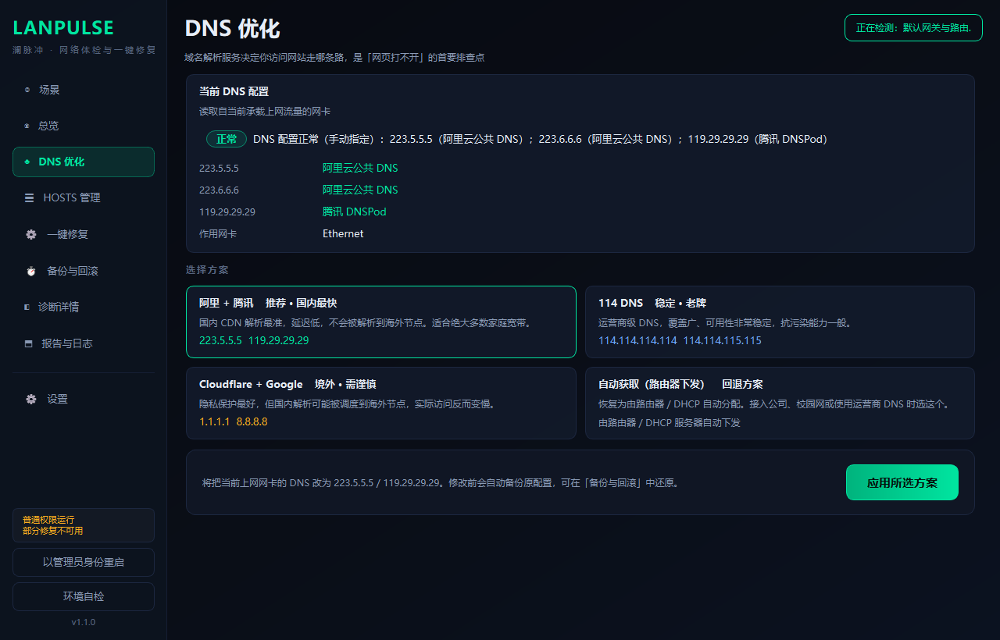
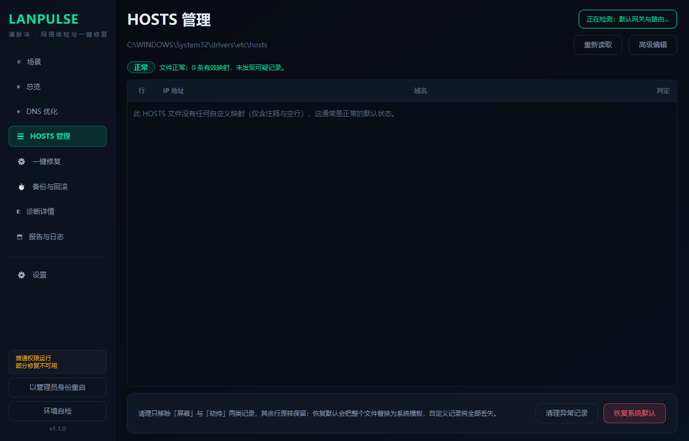
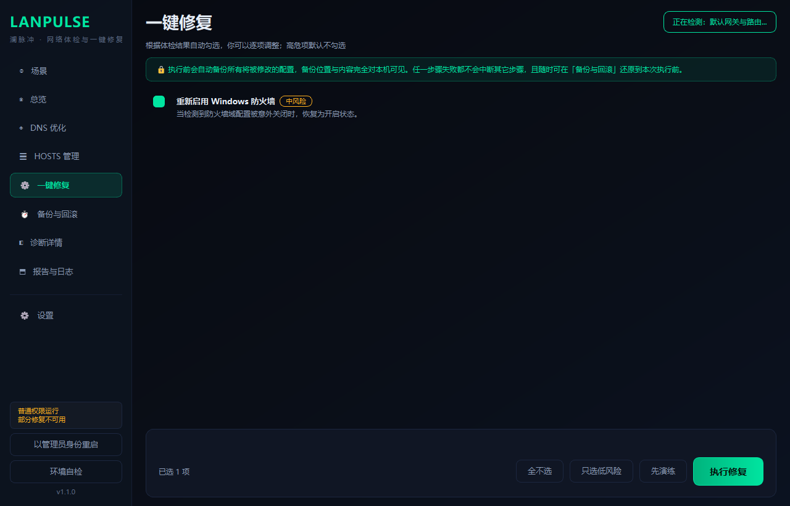
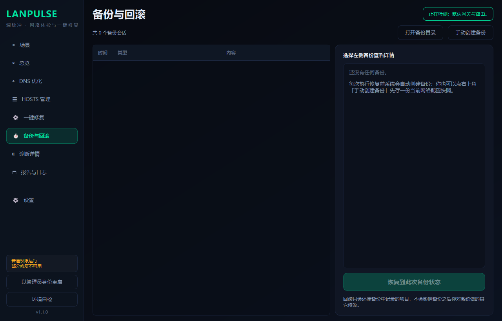
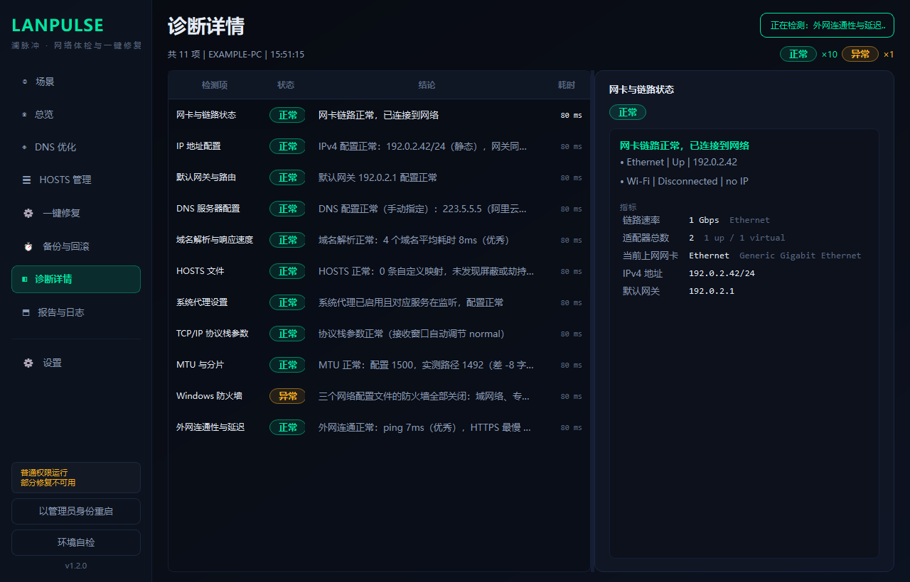
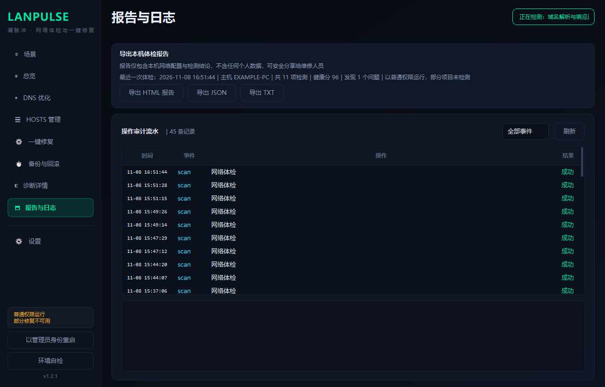
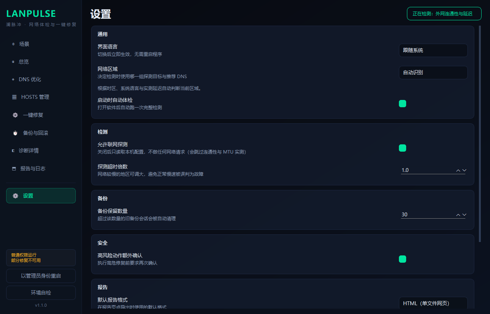

<div align="center">

# LanPulse

**Windows 网络体检与一键修复 · Network diagnostics & one-click repair for Windows**

</div>

[](https://opensource.org/licenses/MIT)
[](https://www.python.org/downloads/)
[](https://github.com/Levanll/LanPulse/releases/latest)
[](https://github.com/Levanll/LanPulse/releases)
[](https://github.com/Levanll/LanPulse)
[](https://github.com/Levanll/LanPulse/actions/workflows/ci.yml)
[](https://www.microsoft.com/windows)
[](#)

**[官方网站](https://levanll.github.io/LanPulse/)** ｜ [源码仓库](https://github.com/Levanll/LanPulse) ｜ [English](README_EN.md) ｜ **中文**



## 10 秒看懂

LanPulse 是一款 Windows 上的网络诊断与修复工具：打开就自动体检，14 个检测单元跑完给你一个 0-100 的健康分和一句话结论；哪里不对，它直接列出可执行的修复项，**改之前一定先备份，改完一定读回校验，随时可以一键还原**。

它和其它「一键修复网络」工具的区别只有三点：**它知道自己在地球上哪个位置**（中国大陆 / 港澳台 / 日韩 / 东南亚 / 南亚 / 澳洲 / 北美 / 欧洲 共 12 套探测与 DNS 推荐剖面，不会拿「百度能不能解析」去判欧洲网络）、**它的每一次系统修改都可回滚**（备份是纯文本 + `.reg`，软件坏了也能手工还原）、**它什么都不上传**（无遥测、无账号、无云端）。

## 核心卖点

| | 卖点 | 具体是什么 | 为什么重要 |
|---|---|---|---|
| 🌍 | **跨区域自适应** | 内置 12 套剖面（中国大陆 / 香港 / 澳门 / 台湾 / 日本 / 韩国 / 新加坡 / 印度 / 澳洲 / 北美 / 欧洲 / 其他）：探测域名、ICMP/TCP 目标、MTU 探测地址、DNS 推荐方案、解析与延迟分级阈值全部按区域切换；自动识别（延迟锚点 → 时区 → 系统语言）后也可手动固定 | 网络工具最容易犯的错是「用本地的尺子量全世界的网络」。在法兰克福拿 `223.5.5.5` 当基准、拿 `www.baidu.com` 当解析样本，只会把正常网络判成故障 |
| 🛡️ | **先备份后修改** | 15 个修复动作全部走同一个备份层；备份记录的是「恢复所需的全部状态」（含 `was_dhcp` 这类模式标记），不是差异；任一备份项失败 → **整轮不执行任何修改** | 半套备份意味着一半配置无法恢复，比什么都不做更危险 |
| ↩️ | **一切可回滚** | 备份是 `manifest.json` + 原始文件快照 + `reg export` 的 `.reg` + 结构化 `state/*.json`；回滚按 `kind` 由唯一分派实现反序恢复，回滚前校验 sha256 | 软件坏了、系统重装了，`hosts.bak` 复制回去、`.reg` 双击导入，备份依然有用 |
| 🧪 | **演练模式** | 「先演练」完整走一遍备份流程（建会话、逐项备份、落盘校验），但不调用任何 `apply()` | 第一次使用就能确认备份链路是通的，再决定要不要真的改 |
| 🔍 | **可审计** | 每次体检 / 修复 / 回滚 / 导出 / HOSTS 编辑都写一行 JSON 到 `audit.jsonl`，含时间、动作、目标、结果、备份会话 id | 「这软件到底对我电脑做了什么」有据可查，不用信任何承诺 |
| 📴 | **零上传** | 没有遥测、没有账号、没有云同步；代码里没有任何上传逻辑。网络请求只有检测用的 ICMP 与 DNS 查询 | 报告含本机网络配置，只应留在本机 |
| 🌐 | **中英双语** | 运行时切换，切换后已打开的窗口立即重绘，无需重启；缺失文案显式渲染为 `⟦key⟧` 而不是静默回退 | 漏翻的地方一眼可见，不会伪装成正常的英文界面 |

## 快速开始

### 1. 下载

到 [Releases](https://github.com/Levanll/LanPulse/releases/latest) 下载其中一个：

| 产物 | 适用 |
|---|---|
| `LanPulse-1.2.2-Setup.exe` | 安装到本机，带开始菜单快捷方式 |
| `LanPulse-1.2.2-win64-portable.zip` | 绿色版，解压即用，不写注册表 |

> **首次运行会弹「Windows 已保护你的电脑」。** 点 **更多信息 → 仍要运行**。这是因为当前发布版本没有代码签名证书，不是软件有问题。

### 2. 打开就是结果

双击启动后会自动开始体检，几秒后得到健康分与问题清单。**不需要管理员权限也能体检**，只有修改类动作需要。

### 3. 需要修的时候

点左下角 **以管理员身份重启** → 在系统弹窗里点「是」→ 进入 **一键修复** 页 → 建议先点 **先演练**。

### 4. 出问题就还原

**备份与回滚** 页 → 选中会话 → **恢复到 xx-xx xx:xx 的状态**。

### 系统要求

| 项目 | 要求 |
|---|---|
| 系统 | Windows 10 **1809+** / Windows 11 / Windows Server 2019+（内置自检的门槛为 build 10240） |
| 权限 | 体检：普通用户即可；修复：需管理员（UAC） |
| 运行时 | 无。安装包/绿色版自带 Python 运行时，不依赖 .NET 或 Node.js |

## 界面预览

| 场景 · 按症状选择 | 总览 · 健康分与根因 |
|---|---|
|  |  |
| *不要求懂技术名词，选「上网很慢」即可开始* | *根因卡片带置信度与证据链，直接给出该做什么* |

| DNS 优化 · 当前配置与方案 | HOSTS 管理 · 只读表格与风险标注 |
|---|---|
|  |  |
| *自动识别当前 DNS 归属，方案卡片带风险提示* | *默认只读；改文件需先进入「高级编辑」* |

| 一键修复 · 逐项勾选与演练 | 备份与回滚 · 会话与内容明细 |
|---|---|
|  |  |
| *每项显示 before → after，高危项默认不勾选* | *备份内容逐项可见，一键还原* |

| 诊断详情 · 14 项全量与原始证据 | 报告与日志 · 三种格式 + 审计流水 |
|---|---|
|  |  |
| *点任意一行展开指标、建议与 JSON 证据* | *HTML / JSON / TXT 与 audit.jsonl 流水* |

| 设置 · 语言与区域 | |
|---|---|
|  | |
| *中文 / English 实时切换，区域决定探测集与阈值* | |

## 能力一览

**14 项检测 · 6 个场景 · 10 条根因规则 · 15 个可回滚修复**

- **按症状入口**：选「上网很慢」而不是「测 DNS」，系统只跑相关检查
- **根因分析**：把多个异常合成 1-3 条结论，带置信度、证据链与已排除项
- **三层深检**：网页分层计时（卡在哪一层）、DNS 篡改比对、下载时延迟评级
- **修复可逆**：每次修改前自动备份，备份为纯文本与 .reg，软件损坏也能手工还原
- **跨区域**：12 套探测剖面，探测目标与阈值随区域变化
- **中英双语**：运行时切换，缺失文案显式可见而非静默回退
- **可审计**：audit.jsonl 记录每一次系统修改

## 为什么需要它

Windows 自带的「网络疑难解答」只会做通用步骤：重启网卡、清 ARP、重置 Winsock。它不会告诉你「你的 DNS 被改成了某个不存在的地址」「HOSTS 里有 37 条指向 `0.0.0.0` 的记录」「MTU 配了 1500 但链路只能过 1492」——而这些恰恰是「能上 QQ 打不开网页」的真实原因。

| 场景 | 系统自带工具 | 手动排障 | LanPulse |
|---|---|---|---|
| 找出问题在哪 | 跑完说「未发现问题」 | 逐条 `ipconfig / netsh` 看输出 | 14 项体检 + 根因分析，一句话结论 + 健康分 |
| DNS 是否异常 | 不检查 | 需要知道该测什么、怎么看延迟 | 实测解析耗时并分档，识别 DNS 归属（阿里/腾讯/Google…） |
| HOSTS 是否被劫持 | 不检查 | 手动翻 `C:\Windows\System32\drivers\etc\hosts` | 逐行解析并分级：正常 / 屏蔽 / 疑似劫持 |
| 改之前能否先看 | — | 靠自己记 | 每项 `before → after` 现读现取，可先演练 |
| 改坏了怎么办 | 系统还原点（若已开） | 凭记忆改回去 | 一键回滚到本次执行前 |
| 到底改了什么 | 无 | 无 | `audit.jsonl` 逐条留痕 |
| 人在欧洲怎么办 | — | 自己查该测哪些目标 | 自动切到 `global` 剖面，用当地人该测的目标 |

## 核心特性

### 诊断 · 先按症状选场景

普通用户不知道"我该测哪一项"。所以入口不是检测清单，而是症状：

| 场景 | 适合 | 跑哪些检查 |
|---|---|---|
| ⏱ 上网很慢 | 网页加载慢、下载慢、视频缓冲久 | DNS 解析 / MTU / 连通性 / 协议栈 等 7 项 |
| ⚡ 经常断网 | 偶尔掉线、需重启路由器 | 网卡 / IP / 网关 / 代理 等 6 项 |
| 🌐 网页打不开 | 网站无法访问，但 QQ 能上 | 网页分层 / HOSTS / 代理 等 6 项 |
| 🎮 游戏卡顿 | 网速够快但延迟高、会议卡 | 缓冲膨胀 / MTU / 网关 等 5 项 |
| 🛡 检查劫持 | 怀疑网站被篡改、跳广告 | HOSTS / DNS 篡改 / 防火墙 等 6 项 |
| ◎ 完整体检 | 全部检查 | 14 项 |

场景**只决定跑哪些检查项，不改变任何一项的判定逻辑**——同一个检测项在任何场景下产出的数据完全一致。

### 根因分析 · 把多个异常合成一句人话

看到"网关异常 + DNS 慢 + MTU 不对"，普通用户并不知道该先修哪个、它们是不是同一个原因。

内置 **10 条规则**跨检测项聚合证据，输出 1-3 条结论：

```
Windows 防火墙处于关闭状态            [置信度 高]
  这是安全风险，不会导致当前无法上网
  → 建议重新启用防火墙
```

每条结论都带：

- **置信度**（高/中/低，不用百分比——避免给出经不起追问的精确数字）
- **证据链**：具体是哪几项数据触发了这条判断
- **已排除的可能**：例如链路和网关都正常时，才敢把 DNS 慢认定为根因
- **可直接执行的动作**：根因直接映射到修复按钮

未被任何规则覆盖的异常会**单独列出**，不强行归因。

### 检测 · 14 个独立单元

| 检测项 | 检查什么 |
|---|---|
| 网卡与链路状态 | 网卡启用/连接状态、链路速率、虚拟网卡识别 |
| IP 地址配置 | APIPA（`169.254.*`）、子网与网关是否同网段、静态/ DHCP |
| 默认网关与路由 | 默认路由是否存在、是否指向当前网卡、多网关优先级 |
| DNS 服务器配置 | 当前 DNS 列表、手动/自动模式、归属厂商识别 |
| 域名解析与响应速度 | 真实 DNS 查询计时（`dnsapi!DnsQuery_W`，绕过缓存） |
| HOSTS 文件 | 逐行解析并分级：正常 / 屏蔽 / 疑似劫持 |
| 系统代理设置 | WinINET 代理开关、死端口检测、PAC 配置 |
| TCP/IP 协议栈参数 | 接收窗口自动调节级别、RSS 等关键参数 |
| MTU 与分片 | DF ping 二分实测路径 MTU，对比配置值 |
| Windows 防火墙 | 域/专用/公用三档开关状态 |
| 外网连通性与延迟 | ping + TCP 443 握手，按区域阈值分级 |
| **网页打开速度** | DNS / TCP / TLS / 首字节四段独立计时 + 证书检查 |
| **DNS 是否被篡改** | 与两个公共 DNS 对比同一域名的解析结果 |
| **下载时延迟** | 空闲 vs 负载下的延迟对比，A-F 评级（缓冲膨胀） |

每个单元由 `run_check()` 统一包裹：计时 + 异常隔离。单个单元崩溃会转为 `SKIP` 并在报告里记录原始异常，**不会让整轮体检失败**。

### 修复 · 15 个原子动作

| 动作 ID | 做什么 | 风险 | 默认勾选 |
|---|---|---|---|
| `dns.flush_cache` | 清空 DNS 解析缓存 | 低 | ✅ |
| `dns.set_public` | 切换至公共 DNS 服务器（可指定方案） | 中 | ✅ |
| `dns.restore_dhcp` | DNS 恢复为自动获取 | 低 | ✅ |
| `hosts.clean_bad_lines` | 清理 HOSTS 中的异常记录 | 中 | ✅ |
| `hosts.restore_default` | HOSTS 恢复为系统默认模板 | **高** | ⬜ |
| `tcp.autotuning` | 恢复 TCP 接收窗口自动调节 | 中 | ✅ |
| `tcp.heuristics` | 关闭启发式窗口缩放限制（Win10 1803+ 已废弃，执行会被跳过） | 中 | ⬜ |
| `tcp.reset_stack` | 重置 TCP/IP 协议栈（**需重启**） | **高** | ⬜ |
| `proxy.reset` | 关闭残留的系统代理 | 中 | ✅ |
| `proxy.restore_auto` | 恢复自动检测代理设置 | 低 | ✅ |
| `adapter.renew_dhcp` | 重新获取 IP 地址（DHCP 续租，**网络中断 3-10 秒**） | 低 | ✅ |
| `adapter.reset_stack` | 重置 Winsock 目录与防火墙规则（**需重启**） | **高** | ⬜ |
| `mtu.optimize` | 按实测结果修正 MTU（需 `target_mtu` 参数） | 中 | ✅ |
| `firewall.ensure_enabled` | 重新启用 Windows 防火墙 | 中 | ✅ |
| `netbios.disable_public` | 公网网卡上禁用 NetBIOS over TCP/IP | 低 | ✅ |

**高危动作默认不勾选**，这一点由单元测试锁定，不靠自觉。

### 执行 · 严格顺序

```text
begin()           创建备份会话目录
  ↓
backup() × N      逐条备份；任一失败 → 立即中止，不执行任何 apply
  ↓
store.save()      备份清单落盘（此后即使崩溃也能回滚）
  ↓
apply() × N       单条失败标记 FAILED，继续执行后续（动作彼此独立）
  ↓
verify() × N      读回校验，写入 ActionResult.verified
  ↓
报告 partial=True 若有失败，明确提示「建议回滚本次会话」
```

**为什么备份失败必须整轮中止**：半套备份意味着一半配置无法恢复。宁可让用户看到「因备份失败未做任何修改」。

**为什么 apply 失败要继续**：各动作操作不同对象（DNS / 代理 / 协议栈），一项失败不应牵连其它。

### 规划 · 不做一刀切

`RepairEngine.plan()` 在备份之前就做三件事：

1. **可用性探针**（`action.available()`）——本机不支持的动作直接剔除并写原因，不留到备份阶段才炸
2. **冲突剔除**——`dns.set_public` 与 `dns.restore_dhcp` 互斥，保留先出现者
3. **参数校验**——`mtu.optimize` 的 `target_mtu` 缺失或越界时**在规划阶段就抛 `ValueError`**，不钳位、不降级

第 3 条是有意为之：用猜的 MTU 改系统会造成 PMTU 黑洞（能解析但打不开网页），比不改更糟。

### 跨区域 · 十二套剖面

| 剖面 | 解析探测域名 | 连通性锚点 | DNS 推荐（按序） | 解析分级阈值 |
|---|---|---|---|---|
| `cn` 中国大陆 | baidu / qq / taobao / bilibili | 223.5.5.5 / 119.29.29.29 | 阿里+腾讯 → 114 → 境外公共 → DHCP | 60 / 150 / 400 ms |
| `hk` 中国香港 | google / cloudflare / yahoo.com.hk | 1.1.1.1 / 9.9.9.9 | Cloudflare+Google → 香港本地 → Quad9 → DHCP | 50 / 140 / 400 ms |
| `mo` 中国澳门 | google / cloudflare / gov.mo | 1.1.1.1 / 9.9.9.9 | Cloudflare+Google → 澳门本地(CTM/MTel) → Quad9 → DHCP | 55 / 150 / 420 ms |
| `tw` 中国台湾 | google / cloudflare / yahoo.com.tw / pchome | 1.1.1.1 / 168.95.1.1 | Cloudflare+Google → HiNet → Quad9 → DHCP | 50 / 140 / 400 ms |
| `jp` 日本 | google / cloudflare / yahoo.co.jp / rakuten | 1.1.1.1 / 202.12.27.33 | 日本本地 → Cloudflare+Google → Quad9 → DHCP | 50 / 140 / 400 ms |
| `kr` 韩国 | google / cloudflare / naver / daum | 1.1.1.1 / 168.126.63.1 | 韩国本地 → Cloudflare+Google → Quad9 → DHCP | 50 / 140 / 400 ms |
| `sg` 新加坡/东南亚 | google / cloudflare / straitstimes / shopee.sg | 1.1.1.1 / 165.21.83.88 | Cloudflare+Google → 新加坡本地 → Quad9 → DHCP | 60 / 160 / 450 ms |
| `in` 印度/南亚 | google / cloudflare / flipkart / rediff | 1.1.1.1 / 49.44.44.44 | Cloudflare+Google → 印度本地 → Quad9 → DHCP | 80 / 220 / 600 ms |
| `au` 澳大利亚/新西兰 | google / cloudflare / abc.net.au / gumtree | 1.1.1.1 / 139.130.4.5 | Cloudflare+Google → 澳洲本地 → Quad9 → DHCP | 80 / 200 / 550 ms |
| `na` 北美 | google / cloudflare / wikipedia / github | 1.1.1.1 / 8.8.8.8 | Cloudflare+Google → Quad9 → OpenDNS → 北美本地 → DHCP | 60 / 160 / 450 ms |
| `eu` 欧洲 | google / cloudflare / wikipedia / heise.de | 1.1.1.1 / 9.9.9.9 | 欧盟公共（GDPR） → Cloudflare+Google → Quad9 → DHCP | 60 / 170 / 450 ms |
| `other` 其他地区 | google / cloudflare / wikipedia / github | 1.1.1.1 / 9.9.9.9 | Cloudflare+Google → Quad9 → OpenDNS → DHCP | 90 / 230 / 600 ms |

`other` 承接所有识别不出的网络，阈值取最宽松一档——**识别不出的用户不应该被误报成故障**。

识别顺序（先强后弱，全部本地信号，**不请求任何地理 IP 数据库或定位 API**）：

1. **延迟打分**：测国内锚点与全球 anycast 锚点的 TCP 握手 RTT，差距超过 60 ms 才采信。这一步只能判定「在不在中国大陆」——东亚各区彼此只差十几毫秒，anycast 又处处就近，光靠延迟分不出具体国家
2. **时区**：读 `TimeZoneKeyName`（不用 `StandardName`——中文系统上它是 `@tzres.dll,-572` 这种不可匹配的资源串），可精确到国家
3. **系统语言**：`zh-CN → cn`、`zh-HK → hk`、`zh-MO → mo`、`zh-TW → tw`、`ja → jp`、`ko → kr`、`en-AU → au`、`en-GB → eu`、欧洲各语种 → `eu`，其余 → `other`

用户随时可在 **设置 → 区域** 固定剖面，检测立即跟随。**接口、阈值、判定逻辑是通用的，只有「往哪里打」是地域相关的**——全部收敛在 `core/region.py` 一个模块里。

> 已知局限：大陆、香港、澳门三地共用 `China Standard Time` 时区键，无法仅凭时区区分，港澳完全依赖系统地区码（`zh-HK` / `zh-MO`）判定。

### 安全 · 三道防线

```text
防线 1  权限层   不索要管理员权限也能体检；需提权的动作在 UI 上先拦截，避免「点了没反应」
   ↓
防线 2  事务层   所有修改前必须先备份，备份失败则整轮不执行
   ↓
防线 3  校验层   每条动作执行后立即读回验证；回滚前校验备份完整性
```

安全不能只写在文档里，必须让用户在操作时看见：

| 措施 | 位置 |
|---|---|
| 高危动作默认不勾选 | 一键修复页（`action_ids.py` 的 `default_selected`，单元测试锁定） |
| 每项显示 `before → after` | 修复页每行，来自 `preview()` 现读现取 |
| 执行前二次确认（清单 + 备份路径 + 高风险提示） | 修复页 `_confirm()` |
| 「先演练」：走完整备份流程但不动系统 | 修复页 `dry_run=True` |
| 逐条三阶段状态（备份 / 执行 / 校验） | 修复页实时刷新 |
| 操作审计流水可查看、可导出 | 报告与日志页 |
| 修改 HOSTS 需先进「高级编辑」并二次确认 | HOSTS 页 |

## 架构概览

```text
                        ┌──────────────────────────────┐
                        │        main.py 启动入口        │
                        │  单实例互斥 → 日志 → Qt → 窗口  │
                        └───────────────┬──────────────┘
                                        │
        ┌───────────────────────────────┼───────────────────────────────┐
        │                               │                               │
        ▼                               ▼                               ▼
┌───────────────┐             ┌──────────────────┐            ┌─────────────────┐
│  app/ui/      │  只读消费    │  core/           │  唯一写系统 │  app/report.py  │
│  7 页面+设置  │ ──────────▶ │  检测引擎        │ ─────────▶ │  HTML/JSON/TXT  │
│  自绘控件主题 │             │  修复引擎/备份层  │            │  app/logging_   │
└───────┬───────┘             └────────┬─────────┘            │  setup(审计)    │
        │                              │                       └─────────────────┘
        │  进度/结果（Qt 信号）          │
        └──────────────────────────────┘
                                       │
                          ┌────────────▼─────────────┐
                          │  Windows 原生能力          │
                          │  netsh / ipconfig / route │
                          │  reg / winreg / WMI-CIM   │
                          │  dnsapi!DnsQuery_W        │
                          └───────────────────────────┘
```

两条硬边界：

- **`core/**` 不 import 任何 Qt**。检测与修复引擎可脱离 UI 单独运行、单独测试（`tools/verify_repair.py` 就是这么用的）。
- **系统写入只有一条路**：所有修改经 `core/backup.py` 的 `BackupStore.capture*()` 记录后，才由 `core/repair/*_actions.py` 的 `apply()` 执行。没有例外。

## 项目结构

```text
LanPulse/
├── core/                  检测与修复引擎（无 UI 依赖）
│   ├── models.py          唯一契约：CheckResult / DiagnosticReport / ActionResult
│   ├── registry.py        检测单元注册与异常隔离
│   ├── checks/            14 个检测单元
│   ├── repair/            15 个原子动作 + 事务编排 + 回滚
│   ├── backup.py          备份/回滚中间层（唯一写系统入口）
│   ├── region.py          跨区域剖面与网络环境识别
│   ├── settings.py        设置持久化
│   └── i18n.py            运行时语言切换
├── app/
│   ├── ui/                主题、自绘控件、9 个页面
│   ├── report.py          HTML / JSON / TXT 报告导出
│   ├── sysutil.py         提权 / 单实例 / 环境自检
│   ├── i18n_zh.py / i18n_en.py
│   └── logging_setup.py   运行日志 + 审计流水
├── installer/             Inno Setup 脚本与许可证
├── scripts/               构建脚本
├── tests/                 单元测试
└── docs/                  设计与使用文档
```

几个值得注意的位置：

| 路径 | 说明 |
|---|---|
| `core/context.py` | 单次体检的只读快照：网卡、HOSTS 原文、命令输出全部惰性采集并缓存，避免 14 个单元各自 `PowerShell` 一遍 |
| `core/platform_win.py` | 所有 Windows 调用的唯一出口（命令执行、原子写入、网卡采集、版本判定） |
| `core/action_ids.py` | 15 个动作的元数据单一来源；检测只输出 id，UI 只按 id 查表，引擎只按 id 派发 |
| `core/repair/rollback.py` | 按 `kind` 分派的唯一回滚实现，回滚前做提权预检（权限不足标 `SKIPPED` 而非 `FAILED`） |
| `tools/verify_repair.py` | 修复引擎自测脚本：规划、参数校验、`dry_run` 执行、回滚，全程不修改系统 |

## 技术栈

| 维度 | 选择 | 理由 |
|---|---|---|
| 语言 | Python 3.12 | 系统调用用 `ctypes` / 标准库即可完成，无编译依赖，迭代快 |
| UI | PySide6 6.8（Qt 6, LGPL） | 自绘能力强（`QPainter` 画渐变弧与发光）、高 DPI 友好、商用授权清晰；比 Electron 小一个量级 |
| 打包 | PyInstaller 6.22，**单目录模式** | 单文件模式每次启动都要解压 Qt 运行时，冷启动 3-6 秒且杀软误报率高；单目录冷启动 < 1.5 秒 |
| 安装包 | Inno Setup 6 | 脚本简单、有官方简体中文语言文件、产物与绿色包都从同一份 spec 产出 |
| 系统调用 | `netsh` / `ipconfig` / `route` / `reg` / WMI-CIM / `winreg` / `dnsapi!DnsQuery_W` / `wininet` | 全部 Windows 原生，无第三方驱动或服务，兼容面最广 |
| 数据格式 | JSON（报告 / 备份清单）、`.reg`（注册表备份）、HTML（可视化报告） | 无数据库，用户可直接用记事本查看与手工还原 |
| 测试 | pytest（纯逻辑，无 GUI、无真实系统修改） | 单元测试跑在 CI 上，不需要开窗口、不需要管理员 |

**运行时依赖为零**：开发与打包只额外需要 `PySide6`、`PyInstaller`、`pytest` 三个包（见 [`requirements-dev.txt`](requirements-dev.txt)），程序本体只用标准库 + PySide6。

## 文档导航

| 文档 | 面向谁 | 内容 |
|---|---|---|
| [使用说明](docs/使用说明.md) | 普通用户 | 每页怎么用、怎么看结论、出问题怎么还原 |
| [设计方案](docs/设计方案.md) | 开发者 / 评审 | 技术选型理由、安全机制、13 个实测缺陷与修复、验证数据 |
| [闭环实测报告](docs/闭环实测报告.md) | 关心安全性的人 | 真实执行修复并回滚的实测记录：12 项状态零差异 |
| [CONTRIBUTING.md](CONTRIBUTING.md) | 贡献者 | 开发环境、跑测试、构建、代码规范、提交规范 |
| [SECURITY.md](SECURITY.md) | 安全研究者 | 漏洞报告渠道、响应时限、支持版本 |
| [CHANGELOG.md](CHANGELOG.md) | 所有人 | 版本变更记录（Keep a Changelog 格式） |

## 更新日志

完整版本历史见 **[CHANGELOG.md](CHANGELOG.md)**；每个版本的二进制与变更摘要见 **[Releases](https://github.com/Levanll/LanPulse/releases)**。

## 后续规划

### 已在路上

- [ ] **代码签名** —— 目前未签名，首次运行会被 SmartScreen 拦一次；计划申请 OV/EV 证书后签名发布
- [ ] **管理员权限下的完整闭环验证** —— 现有测试覆盖纯逻辑与只读路径，「执行 → 回滚」的完整闭环仍以人工 `dry_run` 为主，需要在真实管理员环境补验
- [x] **区域剖面扩充** —— 已从 3 套粗粒度细分；v1.2.0 发布 11 套，澳门作为第 12 套补充于其后

### 考虑中

- [ ] 把检测与修复引擎做成可独立调用的 CLI（`core/` 已经没有 UI 依赖，主要是缺一个入口）
- [ ] 报告增加按问题类型折叠的「维修工单」视图
- [ ] 更多语言的文案表（`t()` 与语言包机制已就绪，只缺翻译）

### 明确不做

- ❌ 遥测、崩溃上报、使用统计
- ❌ 云端账号、配置同步
- ❌ 自动修改 VPN / 隧道网卡的 DNS 与 MTU（会破坏用户既有配置）
- ❌ 任何形式的「静默修复」——所有修改必须由用户勾选并确认

## 贡献与致谢

欢迎 Issue 与 PR。开始之前请读 [CONTRIBUTING.md](CONTRIBUTING.md)，其中有三条不能破的约定：

1. **不引入新的第三方运行时依赖**（PySide6 与标准库已经够用）
2. **所有面向用户的文案走 `t()`**，不硬编码中文或英文
3. **涉及系统修改的代码必须走 `core/backup.py`**，不允许绕过备份层直接写系统

### 缺陷报告

提交前请先看 [已有 Issues](https://github.com/Levanll/LanPulse/issues)。报告里附上**软件内导出的 HTML 报告**会大幅提高定位速度——**导出** 在「报告与日志」页，报告只含本机网络配置与检测结论，不含任何个人数据。

### 致谢

- [PySide6 / Qt](https://www.qt.io/) —— 界面与自绘控件的底座
- [PyInstaller](https://pyinstaller.org/) —— 让 Python 程序能变成一个双击就开的 exe
- [Inno Setup](https://jrsoftware.org/isinfo.php) —— 安装包
- 所有报告过问题的用户 —— 本项目的 9 个实测缺陷里，有一半来自真实环境的反馈

### Star History

[](https://star-history.com/#Levanll/LanPulse&Date)

## 隐私速览

| 问题 | 答案 |
|---|---|
| 会上传数据吗？ | **不会。** 代码里没有任何上传逻辑，没有遥测、没有账号、没有云同步 |
| 会联网吗？ | 只在检测时发起 DNS 查询和 ICMP/TCP 探测，用于判定解析耗时与连通性，**不带任何本机信息**。可用抓包工具验证 |
| 报告里有个人信息吗？ | 只有本机网络配置（网卡名、IP、DNS、MTU 等）与检测结论。含主机名，**分享前请自行确认** |
| 数据存在哪？ | 全部在 `%LOCALAPPDATA%\LanPulse\`：`backups/`（备份）、`logs/app.log`（运行日志）、`logs/audit.jsonl`（操作审计）、`settings.json`（设置） |
| 怎么彻底删除？ | 删程序目录，再删 `%LOCALAPPDATA%\LanPulse\`。**删除前请确认不再需要回滚** |
| 可以关闭联网探测吗？ | 可以。**设置 → 检测策略 → 允许联网探测** 关掉后，所有需要外网的检测项跳过，只看本地配置 |

## 许可证

本项目基于 **[MIT License](LICENSE)** 发布，Copyright (c) 2026 LanPulse Contributors。

你可以自由使用、修改、分发、商用，包括闭源分发；保留版权声明与许可证文本即可。

> **关于修改系统配置。** MIT 许可证按「现状」提供软件，不附带任何担保。本工具会真实修改 Windows 的 DNS、HOSTS、代理、TCP/IP 参数与防火墙设置——虽然每一次修改都先备份、可回滚，但**请务必在执行前确认备份目录可写**（环境自检会告诉你），并对自己的系统负责。

---

<div align="center">

**[⬆ 回到顶部](#lanpulse)**　｜　[English](README_EN.md)　｜　[报告问题](https://github.com/Levanll/LanPulse/issues/new/choose)

</div>
