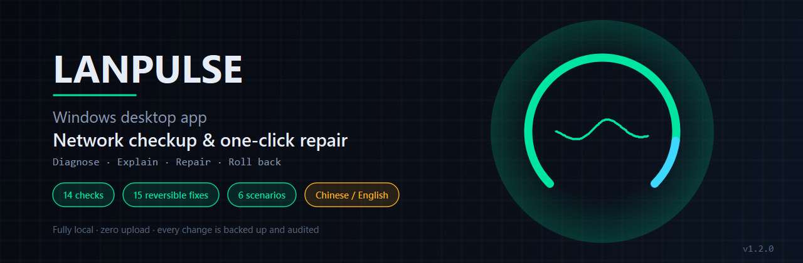
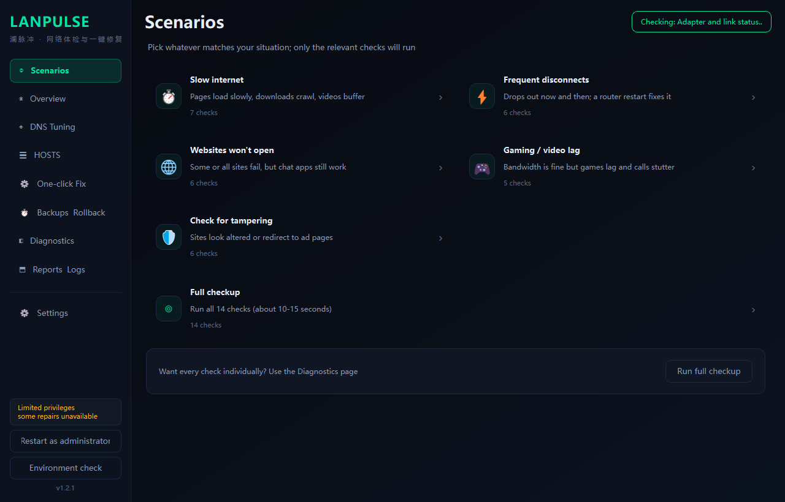
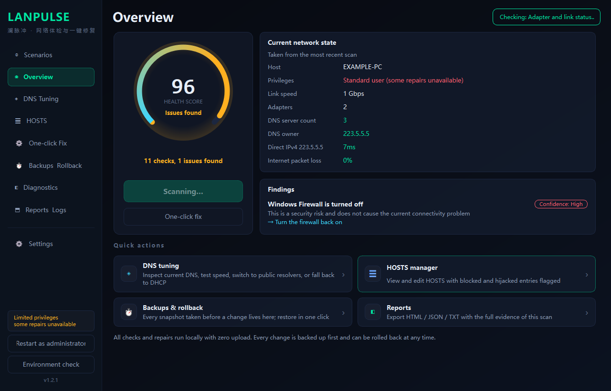
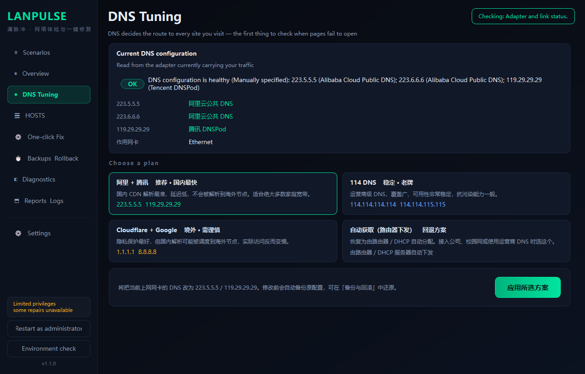
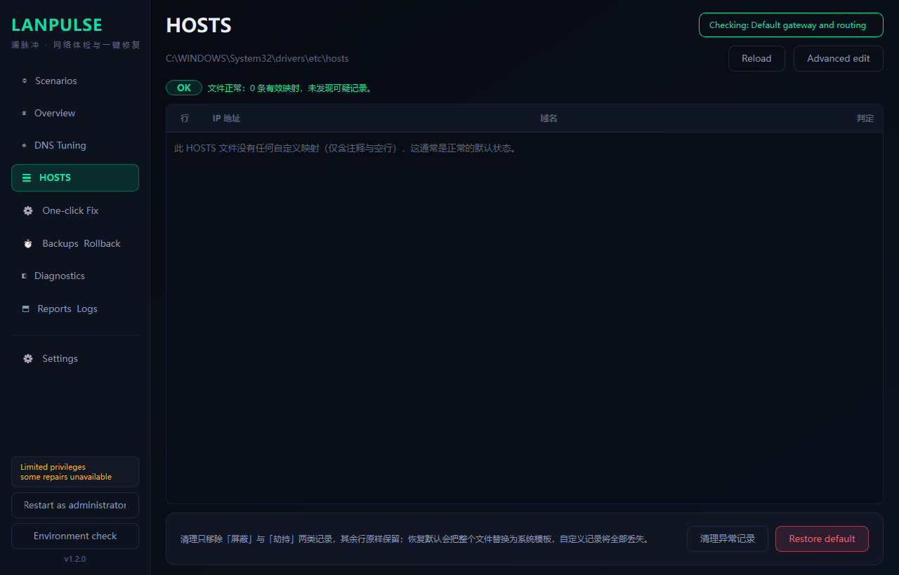
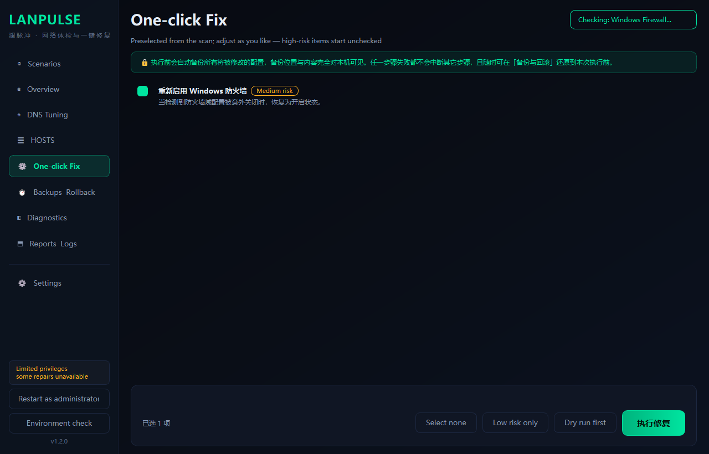
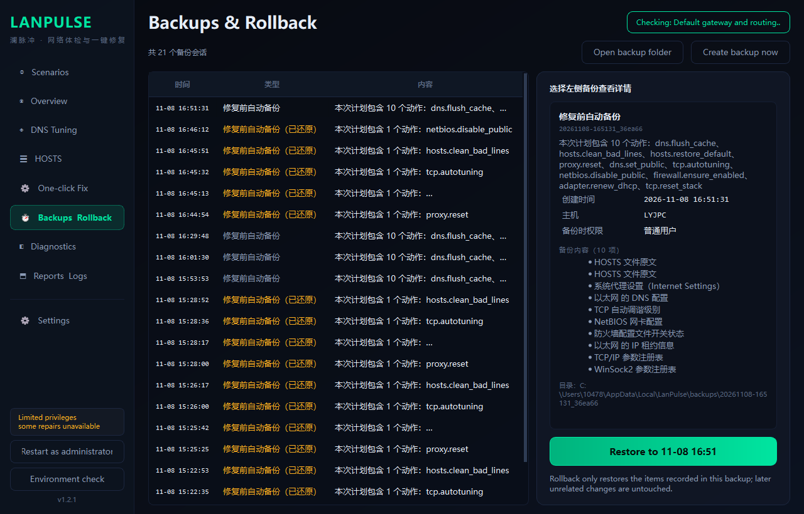
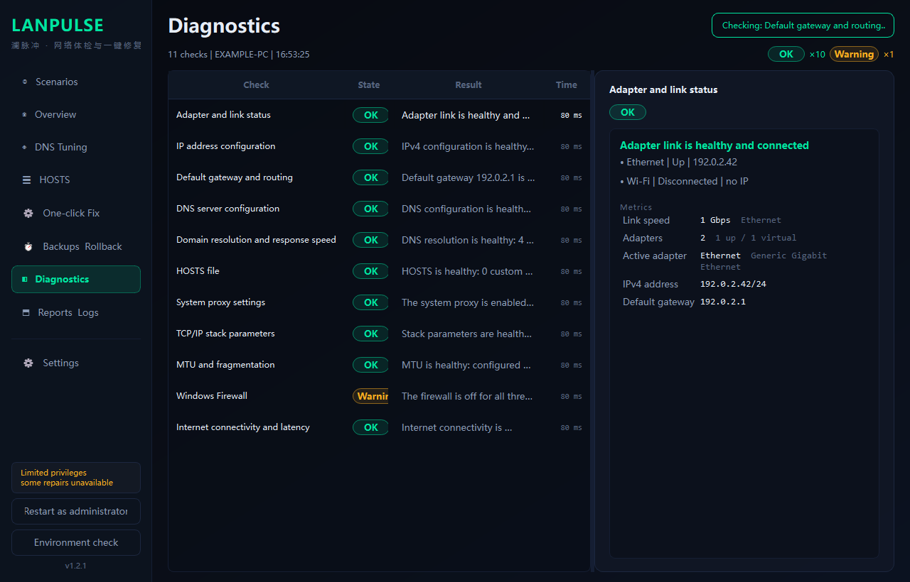
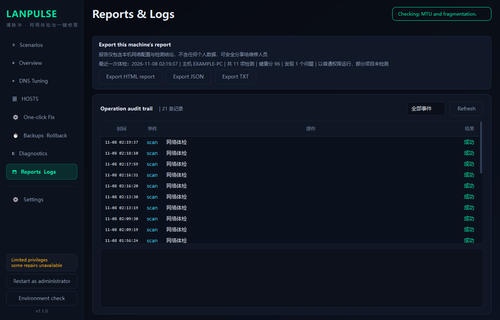
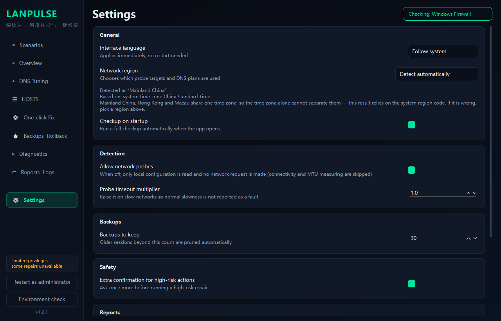

<div align="center">

# LanPulse

**Network diagnostics & one-click repair for Windows**

</div>

[](https://opensource.org/licenses/MIT)
[](https://www.python.org/downloads/)
[](https://github.com/Levanll/LanPulse/releases/latest)
[](https://github.com/Levanll/LanPulse/releases)
[](https://github.com/Levanll/LanPulse)
[](https://github.com/Levanll/LanPulse/actions/workflows/ci.yml)
[](https://www.microsoft.com/windows)
[](#)

**[Website](https://levanll.github.io/LanPulse/en/)** ｜ [Repository](https://github.com/Levanll/LanPulse) ｜ **English** ｜ [中文](README.md)



## Understand it in 10 seconds

LanPulse is a Windows network diagnostic and repair tool. It scans your machine the moment you open it, runs 14 checks, and hands you a 0-100 health score with a one-line verdict. Whatever is broken, it lists the concrete repair actions — and **every change is backed up first, read back and verified after, and reversible at any time**.

Three things separate it from the usual "one-click fix my network" utilities: **it knows where on Earth it is running** (twelve built-in profiles — mainland China, Hong Kong, Macau, Taiwan, Japan, Korea, Singapore, India, Australia, North America, Europe and a catch-all — so it never judges a European connection by whether `baidu.com` resolves), **every system change can be rolled back** (backups are plain text and `.reg` files you can restore by hand even if the app itself breaks), and **nothing ever leaves your machine** (no telemetry, no accounts, no cloud).

## Why it's different

| | Feature | What it actually is | Why it matters |
|---|---|---|---|
| 🌍 | **Region-aware by default** | Twelve profiles — mainland China, Hong Kong, Macau, Taiwan, Japan, Korea, Singapore, India, Australia, North America, Europe and a catch-all — that swap probe domains, ICMP/TCP targets, MTU probe address, recommended DNS presets, and the latency grading thresholds. Auto-detected (latency anchors → timezone → system locale), and pinnable by hand | The classic failure mode of network tools is measuring the whole world with a local ruler. Using `223.5.5.5` as a baseline and `www.baidu.com` as a resolve sample in Frankfurt will report a healthy connection as broken |
| 🛡️ | **Back up before touching anything** | All 15 repair actions go through a single backup layer. A backup captures *the complete state needed to restore* (including mode flags like `was_dhcp`), not a diff. If **any** backup item fails, **nothing is applied at all** | A half-finished backup means half your configuration can never be restored — worse than doing nothing |
| ↩️ | **Everything rolls back** | Backups are a `manifest.json`, raw file snapshots, `reg export` `.reg` files, and structured `state/*.json`. Rollback dispatches on `kind` through one implementation, in reverse order, and verifies sha256 first | If the app is gone and Windows reinstalled, copying `hosts.bak` back and double-clicking a `.reg` still works |
| 🧪 | **Dry-run mode** | "Dry run" walks the entire backup path — creates the session, backs up every item, writes the manifest — but never calls `apply()` | Confirm the backup chain actually works before you let it change anything |
| 🔍 | **Auditable** | Every scan, repair, rollback, export, and HOSTS edit appends one JSON line to `audit.jsonl` with timestamp, action, target, result, and backup session id | "What did this thing do to my PC?" has an answer you can read, not a promise you have to trust |
| 📴 | **Zero upload** | No telemetry, no accounts, no sync. There is no upload code path. The only network traffic is diagnostic ICMP and DNS queries | Reports contain your network configuration; they belong on your machine |
| 🌐 | **Bilingual** | Switch language at runtime and open windows repaint immediately — no restart. A missing string renders as `⟦key⟧` instead of silently falling back | Untranslated spots stay visible instead of masquerading as a normal English UI |

## Quick start

### 1. Download

Grab one of these from [Releases](https://github.com/Levanll/LanPulse/releases/latest):

| Artifact | Use it if |
|---|---|
| `LanPulse-1.2.1-Setup.exe` | You want a normal install with a Start-menu shortcut |
| `LanPulse-1.2.1-win64-portable.zip` | You want the portable build — unzip and run, no registry writes |

> **First launch will trip SmartScreen ("Windows protected your PC").** Click **More info → Run anyway**. Current builds are unsigned; that is all it means.

### 2. Results, immediately

It starts scanning on launch. A few seconds later you get the health score and the problem list. **Scanning needs no admin rights** — only repair actions do.

### 3. When something needs fixing

Click **Restart as administrator** in the bottom-left, accept the UAC prompt, open **One-click repair**, and start with **Dry run**.

### 4. When something goes wrong

**Backup & rollback** → pick a session → **Restore to the state at xx-xx xx:xx**.

### Requirements

| | |
|---|---|
| OS | Windows 10 **1809+** / Windows 11 / Windows Server 2019+ (the built-in self-check gate is build 10240) |
| Privileges | Scanning: standard user. Repairing: administrator (UAC) |
| Runtime | None. Both artifacts bundle the Python runtime — no .NET, no Node.js |

## Screenshots

| Dashboard · health score and problems | DNS optimizer · current config and presets |
|---|---|
| Scenarios · pick by symptom | Overview · health score and root causes |
|---|---|
|  |  |
| *No jargon needed — pick "slow internet" and go* | *Findings carry confidence and an evidence chain* |

| DNS tuning · current config and presets | HOSTS manager · read-only with risk labels |
|---|---|
|  |  |
| *DNS vendors identified automatically; presets carry risk hints* | *Read-only by default; editing requires “Advanced edit”* |

| One-click fix · per-item selection and dry run | Backups & rollback · sessions and contents |
|---|---|
|  |  |
| *Each item shows before → after; high-risk items start unchecked* | *Every backed-up item is visible; restore in one click* |

| Diagnostics · all 14 checks with raw evidence | Reports & logs · three formats plus the audit trail |
|---|---|
|  |  |
| *Click a row to expand metrics, advice, and JSON evidence* | *HTML / JSON / TXT and the audit.jsonl trail* |

| Settings · language and region | |
|---|---|
|  | |
| *Switch Chinese / English in place; region drives probe sets and thresholds* | |

## At a glance

**14 checks · 6 scenarios · 10 root-cause rules · 15 reversible fixes**

- **Symptom-first entry**: pick “slow internet”, not “check DNS” — only relevant checks run
- **Root cause analysis**: collapses several anomalies into 1-3 findings with confidence, evidence chain, and what was already ruled out
- **Three deep checks**: layered web timing (which stage stalls), DNS tampering comparison, latency under load
- **Reversible repairs**: every change is backed up first as plain text and \.reg\ files, restorable even if the app itself breaks
- **Region-aware**: twelve probe sets and threshold profiles
- **Bilingual**: switch at runtime; missing strings surface explicitly instead of silently falling back
- **Auditable**: \udit.jsonl\ records every system change


## Why this exists

Windows' built-in troubleshooter only performs generic steps: reset the adapter, flush ARP, reset Winsock. It will never tell you "your DNS was pointed at an address that no longer exists", "your HOSTS file has 37 entries pointing at `0.0.0.0`", or "MTU is configured as 1500 but the path only carries 1492" — and those are exactly the causes behind "chat works, web pages don't".

| | Built-in troubleshooter | Manual debugging | LanPulse |
|---|---|---|---|
| Finding the problem | Finishes with "no problems detected" | Read `ipconfig` / `netsh` output one by one | 14 checks, one verdict, one score |
| DNS sanity | Not checked | Requires knowing what to test and how latency looks | Real resolve timing, graded, with vendor identification (Alibaba/Tencent/Google…) |
| HOSTS hijacking | Not checked | Manually open `C:\Windows\System32\drivers\etc\hosts` | Parsed line by line, graded: normal / blocked / suspected hijack |
| Seeing changes first | — | Remember it yourself | `before → after` read live for every item, plus dry run |
| Undoing a bad change | System Restore (if enabled) | Reconstruct from memory | One-click rollback to the pre-session state |
| Knowing what changed | Nothing | Nothing | `audit.jsonl`, one line per action |
| Being in Europe | — | Research which targets to test | Switches to the `global` profile automatically |

## Features

### Diagnosis · start from a symptom, not a metric

Users do not know which technical check they need. So the entry point is the symptom:

| Scenario | For | Checks run |
|---|---|---|
| ⏱ Slow internet | Pages crawl, downloads drag, video buffers | DNS lookup / MTU / reachability / stack — 7 checks |
| ⚡ Frequent drops | Drops out now and then; a router restart fixes it | Adapter / IP / gateway / proxy — 6 checks |
| 🌐 Sites won't open | Some or all sites fail while chat apps work | Layered web / HOSTS / proxy — 6 checks |
| 🎮 Gaming lag | Bandwidth fine, latency not | Bufferbloat / MTU / gateway — 5 checks |
| 🛡 Check for tampering | Sites look altered or redirect to ads | HOSTS / DNS tampering / firewall — 6 checks |
| ◎ Full checkup | Everything | 14 checks |

A scenario **only selects which checks run — it never changes how any check decides**. The same check produces identical data in every scenario.

### Root cause analysis · several anomalies, one plain-language finding

Seeing "gateway anomaly + slow DNS + MTU mismatch" leaves a user with no idea what to fix first, or whether these share a cause.

Ten rules aggregate evidence across checks and emit 1-3 findings:

```
Windows Firewall is turned off            [confidence: high]
  This is a security risk and does not cause the current connectivity problem
  → Turn the firewall back on
```

Each finding carries a **confidence** level (high/medium/low rather than a
percentage that cannot be defended), the **evidence chain** that fired the rule,
the **possibilities already excluded**, and the **action to take**.

Anomalies not covered by any rule are listed separately, never force-fitted to a cause.

### Scanning · 14 independent units

| Check | What it inspects |
|---|---|
| Adapter & link state | Enabled/connected state, link speed, virtual adapter detection |
| IP configuration | APIPA (`169.254.*`), subnet vs. gateway consistency, static vs. DHCP |
| Default gateway & routes | Whether a default route exists, whether it points at this adapter, multi-gateway priority |
| DNS server config | Current server list, manual vs. automatic, vendor identification |
| Name resolution & latency | Real timed DNS queries (`dnsapi!DnsQuery_W`, cache bypassed) |
| HOSTS file | Parsed line by line and graded: normal / blocked / suspected hijack |
| System proxy | WinINET proxy state, dead-port detection, PAC configuration |
| TCP/IP stack parameters | Receive-window auto-tuning level, RSS, and related settings |
| MTU & fragmentation | Path MTU measured by DF-ping bisection, compared against the configured value |
| Windows Firewall | Domain / private / public profile states |
| Internet reachability & latency | ICMP plus TCP 443 handshakes, graded against regional thresholds |
| **Web page load speed** | DNS / TCP / TLS / first-byte timed separately, plus certificate checks |
| **DNS tampering** | Same domain queried against two public resolvers and compared |
| **Latency under load** | Idle vs. loaded latency, graded A-F (bufferbloat) |

Every unit is wrapped by `run_check()`, which handles timing and isolation. A crashing unit becomes a `SKIP` result with the original exception recorded in the report — **it never fails the whole scan**.

### Repairing · 15 atomic actions

| Action ID | What it does | Risk | On by default |
|---|---|---|---|
| `dns.flush_cache` | Flush the DNS resolver cache | Low | ✅ |
| `dns.set_public` | Switch to public DNS servers (preset selectable) | Medium | ✅ |
| `dns.restore_dhcp` | Return DNS to automatic | Low | ✅ |
| `hosts.clean_bad_lines` | Remove suspicious entries from HOSTS | Medium | ✅ |
| `hosts.restore_default` | Replace HOSTS with the Windows default template | **High** | ⬜ |
| `tcp.autotuning` | Restore TCP receive-window auto-tuning | Medium | ✅ |
| `tcp.heuristics` | Disable heuristic window scaling (deprecated since Win10 1803 — skipped when run) | Medium | ⬜ |
| `tcp.reset_stack` | Reset the TCP/IP stack (**needs reboot**) | **High** | ⬜ |
| `proxy.reset` | Clear a leftover system proxy | Medium | ✅ |
| `proxy.restore_auto` | Restore automatic proxy detection | Low | ✅ |
| `adapter.renew_dhcp` | Renew the DHCP lease (**network drops 3-10 s**) | Low | ✅ |
| `adapter.reset_stack` | Reset the Winsock catalog and firewall rules (**needs reboot**) | **High** | ⬜ |
| `mtu.optimize` | Set MTU from the measured value (requires `target_mtu`) | Medium | ✅ |
| `firewall.ensure_enabled` | Re-enable Windows Firewall | Medium | ✅ |
| `netbios.disable_public` | Disable NetBIOS over TCP/IP on public adapters | Low | ✅ |

**High-risk actions are never pre-selected**, and that is locked by a unit test rather than good intentions.

### Executing · strict ordering

```text
begin()           create the backup session directory
  ↓
backup() × N      back up each item; any failure → abort, nothing is applied
  ↓
store.save()      persist the manifest (rollback works even after a crash)
  ↓
apply() × N       a failing action is marked FAILED, the rest continue (actions are independent)
  ↓
verify() × N      read back and verify; result lands in ActionResult.verified
  ↓
report partial=True  if anything failed, say "roll back this session"
```

**Why a backup failure aborts everything:** half a backup means half the configuration can't be restored. Better to report "nothing was changed because the backup failed".

**Why an apply failure doesn't:** the actions touch different objects (DNS / proxy / stack). One failure shouldn't drag the others down.

### Planning · no blunt force

`RepairEngine.plan()` does three things *before* the backup phase:

1. **Availability probe** (`action.available()`) — unsupported actions are dropped with a reason, instead of exploding during the backup phase
2. **Conflict removal** — `dns.set_public` and `dns.restore_dhcp` are mutually exclusive; the first one wins
3. **Parameter validation** — a missing or out-of-range `target_mtu` raises `ValueError` **at planning time**; no clamping, no silent fallback

Point 3 is deliberate: guessing an MTU creates a PMTU black hole (names resolve, pages never load), which is worse than leaving it alone.

### Cross-region · twelve profiles

| Profile | Resolve probes | Reachability anchors | DNS presets (in order) | Resolve grading |
|---|---|---|---|---|
| `cn` Mainland China | baidu / qq / taobao / bilibili | 223.5.5.5 / 119.29.29.29 | Alibaba+Tencent → 114 → overseas public → DHCP | 60 / 150 / 400 ms |
| `hk` Hong Kong | google / cloudflare / yahoo.com.hk | 1.1.1.1 / 9.9.9.9 | Cloudflare+Google → HK local → Quad9 → DHCP | 50 / 140 / 400 ms |
| `mo` Macau | google / cloudflare / gov.mo | 1.1.1.1 / 9.9.9.9 | Cloudflare+Google → Macau local (CTM/MTel) → Quad9 → DHCP | 55 / 150 / 420 ms |
| `tw` Taiwan | google / cloudflare / yahoo.com.tw / pchome | 1.1.1.1 / 168.95.1.1 | Cloudflare+Google → HiNet → Quad9 → DHCP | 50 / 140 / 400 ms |
| `jp` Japan | google / cloudflare / yahoo.co.jp / rakuten | 1.1.1.1 / 202.12.27.33 | JP local → Cloudflare+Google → Quad9 → DHCP | 50 / 140 / 400 ms |
| `kr` South Korea | google / cloudflare / naver / daum | 1.1.1.1 / 168.126.63.1 | KR local → Cloudflare+Google → Quad9 → DHCP | 50 / 140 / 400 ms |
| `sg` Singapore / SEA | google / cloudflare / straitstimes / shopee.sg | 1.1.1.1 / 165.21.83.88 | Cloudflare+Google → SG local → Quad9 → DHCP | 60 / 160 / 450 ms |
| `in` India / South Asia | google / cloudflare / flipkart / rediff | 1.1.1.1 / 49.44.44.44 | Cloudflare+Google → IN local → Quad9 → DHCP | 80 / 220 / 600 ms |
| `au` Australia / NZ | google / cloudflare / abc.net.au / gumtree | 1.1.1.1 / 139.130.4.5 | Cloudflare+Google → AU local → Quad9 → DHCP | 80 / 200 / 550 ms |
| `na` North America | google / cloudflare / wikipedia / github | 1.1.1.1 / 8.8.8.8 | Cloudflare+Google → Quad9 → OpenDNS → NA local → DHCP | 60 / 160 / 450 ms |
| `eu` Europe | google / cloudflare / wikipedia / heise.de | 1.1.1.1 / 9.9.9.9 | EU public (GDPR) → Cloudflare+Google → Quad9 → DHCP | 60 / 170 / 450 ms |
| `other` Other regions | google / cloudflare / wikipedia / github | 1.1.1.1 / 9.9.9.9 | Cloudflare+Google → Quad9 → OpenDNS → DHCP | 90 / 230 / 600 ms |

`other` catches every network we cannot identify, with the loosest thresholds of any
profile — **a user we fail to identify should never be told their network is broken**.

Detection order, strongest signal first — all local, **no geo-IP database and no lookup API**:

1. **Latency scoring** — TCP handshake RTT against a China anchor vs. global anycast anchors; a 60 ms gap is required before it is trusted. This can only answer "am I in mainland China": East Asian regions differ by a dozen milliseconds from each other, and anycast is local everywhere, so latency alone cannot pin down a country
2. **Timezone** — reads `TimeZoneKeyName` (not `StandardName`, which returns un-matchable resource strings like `@tzres.dll,-572` on localized Windows); precise down to the country
3. **System locale** — `zh-CN → cn`, `zh-HK → hk`, `zh-MO → mo`, `zh-TW → tw`, `ja → jp`, `ko → kr`, `en-AU → au`, `en-GB → eu`, European languages → `eu`, everything else → `other`

You can pin the profile at **Settings → Region** and detection follows immediately. **The interfaces and grading logic are universal; only "where to aim" is regional** — and that lives in exactly one module, `core/region.py`.

> Known limitation: mainland China, Hong Kong and Macau all share the `China Standard Time`
> key, so the timezone alone cannot tell them apart; the HK and Macau profiles rely entirely
> on the system region code (`zh-HK` / `zh-MO`).

### Safety · three layers

```text
Layer 1  Privileges   Scanning works unelevated; actions that need elevation are
                      blocked in the UI first, so nothing "does nothing" silently
   ↓
Layer 2  Transaction  Nothing is modified before it is backed up; a failed backup
                      aborts the entire round
   ↓
Layer 3  Verification Every action is read back immediately; backup integrity is
                      checked before rollback
```

Safety written only in the docs doesn't count. It has to be visible while you operate:

| Measure | Where |
|---|---|
| High-risk actions unchecked by default | Repair page (`default_selected` in `action_ids.py`, locked by tests) |
| `before → after` per item | Repair page rows, read live from `preview()` |
| Second confirmation with item list, backup path, risk warning | `_confirm()` on the repair page |
| "Dry run" walks the backup path but changes nothing | Repair page, `dry_run=True` |
| Three-phase per-item state (backup / apply / verify) | Repair page, live |
| Audit trail, viewable and exportable | Reports & logs page |
| HOSTS edits require entering "Advanced edit" and confirming | HOSTS page |

## Architecture

```text
                        ┌──────────────────────────────┐
                        │        main.py entry point    │
                        │  mutex → logging → Qt → window│
                        └───────────────┬──────────────┘
                                        │
        ┌───────────────────────────────┼───────────────────────────────┐
        │                               │                               │
        ▼                               ▼                               ▼
┌───────────────┐             ┌──────────────────┐            ┌─────────────────┐
│  app/ui/      │  read only  │  core/           │ only system │  app/report.py  │
│  9 pages+set. │ ──────────▶ │  check engine    │ write path  │  HTML/JSON/TXT  │
│  widgets/theme│             │  repair + backup │ ─────────▶  │  app/logging_   │
└───────┬───────┘             └────────┬─────────┘             │  setup (audit)  │
        │                              │                       └─────────────────┘
        │  progress / results (Qt)     │
        └──────────────────────────────┘
                                       │
                          ┌────────────▼─────────────┐
                          │  Native Windows APIs      │
                          │  netsh / ipconfig / route │
                          │  reg / winreg / WMI-CIM   │
                          │  dnsapi!DnsQuery_W        │
                          └───────────────────────────┘
```

Two hard boundaries:

- **`core/**` never imports Qt.** The engines run and are tested without a UI (`tools/verify_repair.py` does exactly that).
- **There is exactly one path to writing the system**: changes are captured through `BackupStore.capture*()` in `core/backup.py` and only then applied by an `apply()` in `core/repair/*_actions.py`. No exceptions.

## Project layout

```text
LanPulse/
├── core/                  check & repair engines (no UI dependency)
│   ├── models.py          the single contract: CheckResult / DiagnosticReport / ActionResult
│   ├── registry.py        check registration and exception isolation
│   ├── checks/            14 check units
│   ├── repair/            15 atomic actions + transaction orchestration + rollback
│   ├── backup.py          backup/rollback layer (the only path that writes the system)
│   ├── region.py          region profiles and network-environment detection
│   ├── settings.py        persisted settings
│   └── i18n.py            runtime language switching
├── app/
│   ├── ui/                theme, custom widgets, 9 pages
│   ├── report.py          HTML / JSON / TXT report export
│   ├── sysutil.py         elevation / single instance / environment self-check
│   ├── i18n_zh.py / i18n_en.py
│   └── logging_setup.py   runtime log + audit trail
├── installer/             Inno Setup script and license
├── scripts/               build scripts
├── tests/                 unit tests
└── docs/                  design and user documentation
```

Worth knowing about:

| Path | Why |
|---|---|
| `core/context.py` | Read-only snapshot per scan: adapters, HOSTS text, command output are collected lazily and cached, so 11 units don't each spawn PowerShell |
| `core/platform_win.py` | The only exit point for Windows calls (command execution, atomic writes, adapter collection, version checks) |
| `core/action_ids.py` | Single source of truth for all 15 actions; checks emit ids, the UI looks ids up, the engine dispatches on ids |
| `core/repair/rollback.py` | The only rollback implementation, dispatched by `kind`, with an elevation pre-check (insufficient rights become `SKIPPED`, not `FAILED`) |
| `tools/verify_repair.py` | Engine self-test: planning, parameter validation, `dry_run` execution, rollback — without modifying the system |

## Tech stack

| | Choice | Why |
|---|---|---|
| Language | Python 3.12 | System calls work through `ctypes` and the standard library; no compile step, fast iteration |
| UI | PySide6 6.8 (Qt 6, LGPL) | Strong custom drawing (`QPainter` gradients and glow), high-DPI friendly, clear commercial licensing; an order of magnitude smaller than Electron |
| Packaging | PyInstaller 6.22, **one-directory mode** | One-file mode re-extracts the Qt runtime on every launch (3-6 s cold start) and triggers more AV false positives; one-directory starts in under 1.5 s |
| Installer | Inno Setup 6 | Simple scripts, an official Simplified Chinese language file, and both artifacts come from the same spec |
| System layer | `netsh` / `ipconfig` / `route` / `reg` / WMI-CIM / `winreg` / `dnsapi!DnsQuery_W` / `wininet` | All native, no third-party drivers or services, widest compatibility |
| Data formats | JSON (reports, backup manifests), `.reg` (registry backups), HTML (visual report) | No database; everything readable in Notepad and restorable by hand |
| Tests | pytest (pure logic; no GUI, no real system changes) | The suite runs in CI without opening a window or needing admin rights |

**Zero runtime dependencies.** Development and packaging need exactly three extra packages — `PySide6`, `PyInstaller`, `pytest` (see [CONTRIBUTING.md](CONTRIBUTING.md)). The application itself uses only the standard library plus PySide6.

## Documentation

| Document | Audience | Contents |
|---|---|---|
| [User guide](docs/使用说明.md) (Chinese) | End users | Every page, how to read a verdict, how to restore |
| [Design notes](docs/设计方案.md) (Chinese) | Developers / reviewers | Technology rationale, safety model, 13 real defects and their fixes, validation data |
| [Closed-loop test report](docs/闭环实测报告.md) (Chinese) | Anyone evaluating safety | A real repair-then-rollback run: 12 state probes, zero difference after restore |
| [CONTRIBUTING.md](CONTRIBUTING.md) | Contributors | Dev setup, tests, builds, code rules, commit conventions |
| [SECURITY.md](SECURITY.md) | Security researchers | Reporting channel, response times, supported versions |
| [CHANGELOG.md](CHANGELOG.md) | Everyone | Version history (Keep a Changelog) |

## Changelog

Full history in **[CHANGELOG.md](CHANGELOG.md)**; binaries and per-release notes in **[Releases](https://github.com/Levanll/LanPulse/releases)**.

## Roadmap

### In progress

- [ ] **Code signing** — currently unsigned, so SmartScreen warns once on first launch; an OV/EV certificate is the plan
- [ ] **Full elevated end-to-end validation** — the current suite covers pure logic and read-only paths; the full apply → rollback loop is still verified by manual dry runs and needs a real administrator environment
- [x] **More region profiles** — done in v1.2.0: 3 coarse profiles split into 12

### Under consideration

- [ ] A standalone CLI over the engines (`core/` is already UI-free; it just needs an entry point)
- [ ] A "repair worksheet" report view grouped by problem type
- [ ] More language catalogs (`t()` and the catalog mechanism are ready; only translations are missing)

### Explicitly out of scope

- ❌ Telemetry, crash reporting, usage statistics
- ❌ Cloud accounts or configuration sync
- ❌ Automatically changing DNS or MTU on VPN / tunnel adapters (that would break your existing configuration)
- ❌ Any form of "silent repair" — every change is selected and confirmed by you

## Contributing

Issues and pull requests are welcome. Read [CONTRIBUTING.md](CONTRIBUTING.md) first — three rules are non-negotiable:

1. **No new third-party runtime dependencies** (PySide6 and the standard library are enough)
2. **All user-facing text goes through `t()`** — no hard-coded Chinese or English strings
3. **Anything that modifies the system must go through `core/backup.py`** — never write the system directly

### Reporting a bug

Check [existing issues](https://github.com/Levanll/LanPulse/issues) first. Attaching an **HTML report exported from the app** speeds diagnosis up dramatically — **Export** lives on the Reports & logs page, and the report contains only your network configuration and check results, no personal data.

### Credits

- [PySide6 / Qt](https://www.qt.io/) — the foundation for the UI and custom-drawn widgets
- [PyInstaller](https://pyinstaller.org/) — turns a Python program into a double-clickable exe
- [Inno Setup](https://jrsoftware.org/isinfo.php) — the installer
- Everyone who reported a problem — half of this project's 9 real defects came from actual environment feedback

### Star History

[](https://star-history.com/#Levanll/LanPulse&Date)

## Privacy at a glance

| Question | Answer |
|---|---|
| Does it upload anything? | **No.** There is no upload code path — no telemetry, no accounts, no sync |
| Does it use the network? | Only diagnostic DNS queries and ICMP/TCP probes, used to time resolution and reachability. They carry no machine information. Verify with a packet capture |
| Does the report contain personal data? | Only your network configuration (adapter names, IPs, DNS, MTU…) and check results. It includes the hostname — **review before sharing** |
| Where does data live? | All under `%LOCALAPPDATA%\LanPulse\`: `backups\`, `logs\app.log`, `logs\audit.jsonl`, `settings.json` |
| How do I remove everything? | Delete the program folder, then `%LOCALAPPDATA%\LanPulse\`. **Make sure you no longer need a rollback first** |
| Can I turn probing off? | Yes. **Settings → Scanning → Allow network probing** disables every check that needs the internet; only local configuration is inspected |

## License

Released under the **[MIT License](LICENSE)**, Copyright (c) 2026 LanPulse Contributors.

Use it, modify it, redistribute it, ship it commercially, even closed-source — just keep the copyright notice and the license text.

> **A note on modifying system configuration.** MIT provides this software "as is", without warranty. This tool genuinely changes Windows DNS, HOSTS, proxy, TCP/IP, and firewall settings. Every change is backed up and reversible, but **confirm the backup directory is writable first** (the environment self-check tells you), and take responsibility for your own machine.

---

<div align="center">

**[⬆ Back to top](#lanpulse)**　｜　[中文](README.md)　｜　[Report an issue](https://github.com/Levanll/LanPulse/issues/new/choose)

</div>
